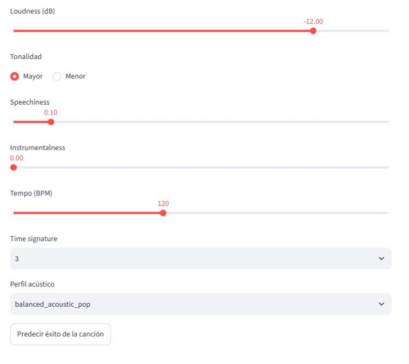
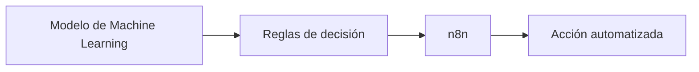
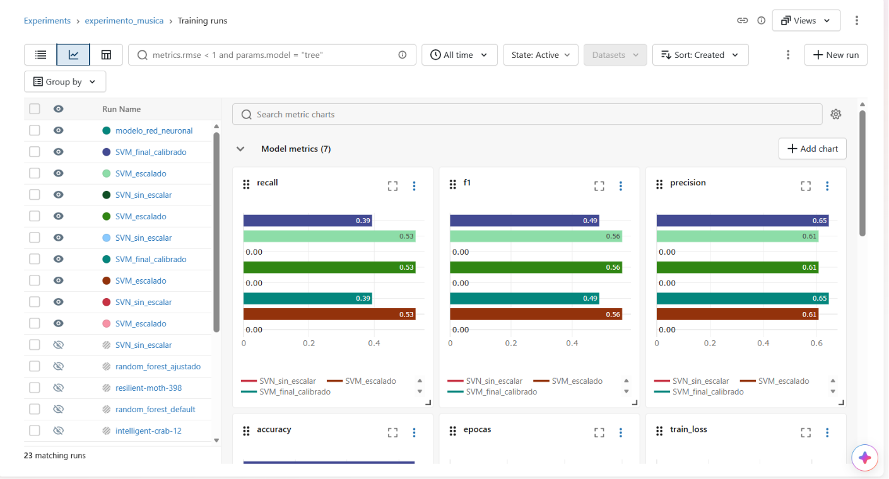
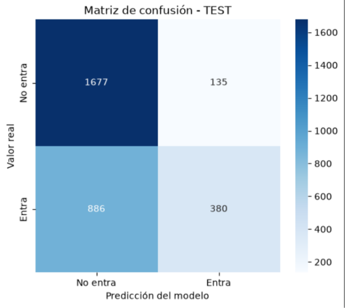

# 🎵 Spotify Music Analysis & Machine Learning

Sistema inteligente de análisis musical que utiliza datos de Spotify y técnicas de Machine Learning para identificar patrones musicales, predecir la popularidad de las canciones y automatizar acciones mediante n8n.

---

## 📸 Aplicación desarrollada

Aplicación interactiva desarrollada con Streamlit que permite visualizar los resultados del análisis y consultar las predicciones del sistema.

**📷 CAPTURA 1: Pantalla principal de Streamlit**

Guarda aquí la captura con el nombre `streamlit.png`.

---

## 📌 1. Necesidad de negocio

La gran cantidad de canciones disponibles en plataformas musicales como Spotify hace que resulte interesante disponer de herramientas capaces de analizar sus características y detectar patrones que permitan comprender mejor el comportamiento de la música.

La necesidad que aborda este proyecto es desarrollar un sistema que permita analizar las características musicales de las canciones, identificar diferentes perfiles musicales y estudiar qué factores pueden estar relacionados con su popularidad.

Para ello, se plantea una solución que combina técnicas de análisis de datos, Machine Learning y automatización de procesos.

El sistema permite:

- Analizar las características musicales de las canciones.
- Identificar patrones y agrupaciones según sus características.
- Estudiar la relación entre los atributos musicales y la popularidad.
- Obtener predicciones mediante modelos de Machine Learning.
- Aplicar reglas de decisión sobre los resultados obtenidos.
- Automatizar acciones mediante n8n.

---

## ⚙️ 2. ¿Qué hemos construido?

Se ha desarrollado un sistema que integra análisis de datos, modelos de Machine Learning, reglas de decisión y automatización mediante n8n.

### Arquitectura del sistema

El funcionamiento general sigue el siguiente flujo:

### Funcionamiento

1. **Modelo:** analiza las características musicales de las canciones y genera una predicción.
2. **Reglas:** interpreta los resultados del modelo y determina qué condiciones se cumplen.
3. **n8n:** recibe la información y gestiona el flujo de automatización.
4. **Acción:** se ejecuta la acción correspondiente según las reglas establecidas.

### Inteligencia artificial débil

El sistema se considera un ejemplo de **IA débil o estrecha (Narrow AI)** porque está diseñado para realizar tareas específicas relacionadas con el análisis musical y la predicción. No posee inteligencia general ni capacidad de razonamiento independiente fuera de las tareas para las que ha sido desarrollado.

### Tipo de aprendizaje

Se utilizan técnicas de **aprendizaje supervisado (Supervised Learning)** para entrenar modelos de clasificación a partir de datos etiquetados.

Además, se trabaja con agrupaciones (*Mood Clusters*) para identificar patrones musicales y estudiar las similitudes entre canciones.

---

## 📊 3. Los datos

El proyecto utiliza un conjunto de datos de canciones de Spotify que contiene información sobre sus características musicales, artistas, géneros y popularidad.

### Principales variables del dataset

| Variable | Descripción |
|---|---|
| `performer` | Artista o intérprete |
| `spotify_genre` | Género musical |
| `spotify_track_duration_ms` | Duración de la canción |
| `spotify_track_explicit` | Indica si contiene contenido explícito |
| `danceability` | Facilidad para bailar |
| `loudness` | Nivel de volumen |
| `speechiness` | Presencia de palabras habladas |
| `instrumentalness` | Probabilidad de que sea instrumental |
| `tempo` | Velocidad de la canción |
| `acoustic_mood_cluster` | Agrupación según características musicales |
| `top30` | Variable relacionada con la popularidad |

### Análisis exploratorio (EDA)

Se realiza un análisis exploratorio para comprender el comportamiento de los datos, detectar patrones y estudiar las relaciones entre las diferentes características musicales.

Se utilizan diferentes técnicas de visualización:

- Histogramas para analizar la distribución de las variables numéricas.
- Gráficos de barras para estudiar variables categóricas.
- Diagramas de dispersión para identificar relaciones entre características musicales.
- Boxplots para comparar las características entre diferentes *Mood Clusters*.
- Mapas de calor para visualizar perfiles medios y correlaciones.

### Principales descubrimientos

- **Danceability:** [Añadir el descubrimiento principal sobre la facilidad para bailar].
- **Mood Clusters:** [Explicar las diferencias más importantes entre las agrupaciones musicales].
- **Características musicales:** [Añadir las relaciones más interesantes encontradas entre las variables].
- **Popularidad:** [Explicar qué características parecen estar relacionadas con la popularidad].

## 🤖 4. Modelos de Machine Learning

Se entrenan y comparan diferentes algoritmos de clasificación para estudiar su capacidad predictiva.

### Modelos utilizados

- **Regresión Lineal:** algoritmo que modela la relación entre las variables de entrada y una variable objetivo mediante una función lineal.
- **K-Nearest Neighbors (KNN):** algoritmo que realiza predicciones basándose en la proximidad entre observaciones.
- **Support Vector Machine (SVM):** algoritmo que busca el hiperplano óptimo para separar las diferentes clases.
- **Random Forest:** modelo basado en un conjunto de árboles de decisión que combina sus predicciones para mejorar la clasificación.
- **XGBoost:** algoritmo de boosting que combina árboles de decisión de forma secuencial para mejorar el rendimiento predictivo.
- **Red Neuronal:** modelo inspirado en el funcionamiento de las redes neuronales biológicas, compuesto por capas de neuronas que aprenden patrones complejos a partir de los datos.

### Optimización de hiperparámetros

Se realizan diferentes pruebas con combinaciones de hiperparámetros para encontrar las configuraciones que ofrecen mejores resultados.

La métrica principal utilizada para comparar los modelos es el **F1-score**, buscando un equilibrio entre precisión y exhaustividad.

### Seguimiento de experimentos con MLflow

Se utiliza MLflow para registrar los experimentos, almacenar parámetros y métricas, y facilitar la comparación de las diferentes configuraciones de los modelos.

---

## 📈 5. Resultados y evaluación

### Comparación de modelos

Los resultados de los experimentos se obtienen a partir de los registros almacenados en MLflow.

| Modelo | F1-score Train | F1-score Validación |
|---|---:|---:|
| KNN | [Valor] | [Valor] |
| Random Forest | [Valor] | [Valor] |
| XGBoost | [Valor] | [Valor] |

📷 CAPTURA 5: Vista de MLflow con los experimentos y sus métricas.

### Modelo seleccionado

**Modelo elegido: Red neuronal**

Se selecciona este modelo porque presenta los mejores resultados en la evaluación de validación, teniendo en cuenta principalmente el F1-score y su comportamiento general.

La selección permite elegir la configuración que ofrece el mejor equilibrio entre precisión y capacidad para identificar correctamente las canciones de la clase positiva.

### Evaluación final en test

Una vez seleccionado el modelo, se realiza su evaluación sobre el conjunto de test para comprobar su capacidad de generalización sobre datos que no han intervenido en el entrenamiento ni en la selección del modelo.

### Matriz de confusión

📷 CAPTURA 6: Matriz de confusión del modelo seleccionado sobre test.

Guardar como `matriz_confusion.png`.

La matriz de confusión permite analizar los aciertos y errores del modelo, identificando los falsos positivos y falsos negativos.

---

## 🛠️ 6. Tecnologías y herramientas

### Lenguajes y entorno de desarrollo

  

### Librerías y herramientas

  
  
  
  
  
  
  
  
  

- Python
- Pandas y NumPy
- Matplotlib y Seaborn
- Scikit-learn
- XGBoost
- MLflow
- Streamlit
- n8n
- Jupyter Notebook
- Git y GitHub

---

## 👩‍💻 Autores

- Alicia Martinez
- Xabier Garcia

---

*Proyecto desarrollado como parte de la especialización en Inteligencia Artificial y Big Data.*
